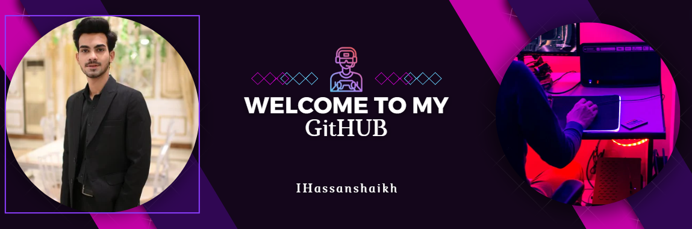

 

# Hi, I'm Muhammad Hassan 👋

### Full-Stack Developer · AI Automation Developer · CS Student

I build **modern web applications, AI-powered systems, and automated workflows** that turn ideas into practical products.

 

  

---

## 👨‍💻 About Me

I'm **Muhammad Hassan**, a Computer Science student and Full-Stack Developer interested in building software that solves real problems.

My work combines **web development, backend engineering, AI, APIs, and automation**.

I enjoy working through the complete product lifecycle:

**Idea → Architecture → Development → Automation → Deployment**

Currently, I'm diving deeper into **AI agents, RAG systems, LLM applications, workflow automation, computer vision, IoT, and scalable backend systems.**

---

## ⚡ What I Do

<table>
<tr>
<td width="50%" valign="top">

### 🌐 Full-Stack Development

Build responsive, scalable and production-ready web applications.

* React & Next.js
* Node.js & Express
* PHP & Laravel
* REST APIs
* MongoDB & PostgreSQL
* Authentication & backend systems

</td>
<td width="50%" valign="top">

### 🤖 AI & Automation

Build intelligent systems that automate real-world workflows.

* LLM Applications
* AI Agents
* RAG Systems
* AI API Integrations
* n8n Automation
* Voice AI
* Automated Business Workflows

</td>
</tr>

<tr>
<td width="50%" valign="top">

### 🛒 E-Commerce

Develop and automate modern online stores.

* WooCommerce
* Shopify
* Custom WordPress
* Payment Integrations
* Analytics & Tracking
* CRM Integrations

</td>
<td width="50%" valign="top">

### 🔌 APIs & Integrations

Connect platforms and services into unified systems.

* REST APIs
* Webhooks
* Third-party APIs
* CRM Integrations
* Analytics APIs
* AI APIs
* Workflow Orchestration

</td>
</tr>
</table>

---

## 🛠️ Tech Stack

### Frontend

### Backend & Databases

### Tools & DevOps

### Platforms & Automation

---

## 🚀 Featured Projects

### 🏏 VectorBat — AI Cricket Bat Tracking System

An AI-powered cricket performance system combining **IoT sensors, mobile technology, data analysis, and AI** to analyze batting performance.

**What it tracks:**

`Bat Speed` · `Shot Power` · `Impact Intensity` · `Swing Path` · `Bat Angle` · `Swing Consistency`

**Tech**

---

### 🤖 AI Automation Systems

AI-powered workflows designed to automate repetitive business operations.

**Examples**

* AI email workflows
* Lead processing automation
* CRM automation
* LLM-powered assistants
* RAG knowledge systems
* API-driven AI workflows

**Tech**

---

### 🌐 Full-Stack Web Platforms

Production-focused web applications built with modern frontend and backend technologies.

**Focus**

* Responsive interfaces
* REST API architecture
* Authentication
* Database design
* Third-party integrations
* Performance optimization
* Deployment & server configuration

---

## 📊 GitHub Activity

 

---

## 🧠 Currently Exploring

---

## 💡 How I Think About Development

> **Don't just build features. Build systems that solve problems.**

I like projects where **software, automation, APIs, and AI work together** to reduce manual work and create something genuinely useful.

My goal is to keep improving across the full engineering stack — from the interface users interact with to the infrastructure and intelligence running behind it.

---

## 🤝 Let's Connect

I'm always interested in discussing:

**Full-Stack Development · AI · Automation · SaaS · APIs · IoT · Developer Tools**

  

### ⭐ Build. Automate. Improve. Repeat.

Thanks for visiting my profile.

